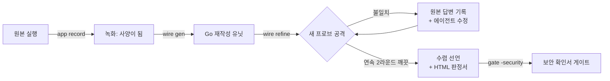

<p align="center">
  <a href="https://gitreels.com/acc0mplish/go-anything"></a>
  <br>
  <a href="https://gitreels.com"></a>
</p>

<div align="center">

# go-anything

**원본의 동작을 기록하고, 재작성을 판정하고, 에이전트가 일치 완료할 때까지 고치게 한다**

[](https://github.com/acc0mplish/go-anything/releases/tag/v0.38.0)
[](https://go.dev)
[](#-검증)
[](LICENSE)

[English](./README.en.md) · [릴리스](https://github.com/acc0mplish/go-anything/releases) · [문서](./docs) · [현재 작업 현황](./docs/STATUS.md) · [전체 워크플로우](./docs/WORKFLOW.md) · [용어 정리](./docs/TERMS.md)

</div>

---

> **"완성된 것 같다"는 증거가 아니다.**
>
> 마이그레이션이 실패하는 지점은 컴파일이 아니라 동작이다. 우연히 같은 출력, 우연히 같은 상태 코드,
> 그리고 아무도 시도하지 않은 입력. go-anything은 **원본의 실제 응답을 사양**으로 삼고,
> 매 라운드 새로운 점검 요청으로 재작성을 공격하며, 불일치가 하나도 남지 않은 라운드가
> **서로 다른 시드에서 연속 두 번** 나오기 전까지 일치 완료라고 말하지 않는다.

---

## 이게 뭔데, 왜 쓰는데

| 당신의 상황 | go-anything이 하는 일 |
|---|---|
| Python 서비스를 Go로 옮기고 있다 | 원본의 모든 응답을 기록해 사양으로 만든다 |
| "테스트 다 통과했는데요"가 무섭다 | 기록된 입력 말고 **새로 만든 입력**으로 계속 공격한다 |
| 재작성이 유지보수를 망칠까 걱정된다 | 에이전트가 원본 소스는 **못 보게 막힌 채**(클린룸) 동작만 보고 고친다 |
| B2B라서 다른 회사 데이터가 새면 끝이다 | 주체마다 요청을 다시 보내 권한 구조를 판정한다 (`rbac`) |
| 한국 공공 조달을 준비 중이다 | 국가정보원 보안요구사항 조항 29개를 코드로 대조한다 (`secure`) |
| 원본이 이상하게 죽는다 | 원본 결함을 **결함으로 분리**해 기록에 섞지 않는다 |

## 30초 흐름



## 무대 뒤에서 실제로 일어나는 일

실측입니다. Python 원본 + Go 재작성 쌍에 에이전트(GLM 5.3)를 연결해 돌린 라운드 로그입니다.

| 라운드 | 점검 요청 | 불일치 | 무슨 일이 있었나 |
|---|---|---|---|
| 1 | 137 | **7** | 유니코드 숫자, 소문자 `get`의 501 HTML 동작 발견 |
| 2 | 135 | **66** | 에이전트가 주문 1·7번만 하드코딩 → 루프가 과적합을 즉시 폭로 |
| 3 | 135 | **0** | 에이전트가 일반 규칙(`total = id × 25`)으로 재작성 |
| 4 | 140 | **0** | 다른 시드. **일치 완료 선언.** 원본 결함 3건은 별도 분리 |

과적합한 에이전트를 66개 불일치로 잡아내는 것이 이 도구의 존재 이유입니다.

## 기능 투어

| 기능 | 지원 | 하는 일 |
|---|:---:|---|
| `record` / `verify` | ✅ | CLI 원본 기록, 재작성 판정. `-json-body` `-float-tolerance` `-normalize timestamps` |
| `app record` / `app replay` | ✅ | HTTP 서비스 전체 기록과 재생. `-repeat`로 불안정 응답 자동 감지, `app replay -case` 단일 재생. `app record`에 `-delay-ms` `-retries` `-retry-delay-ms`를 주면 전송 실패(연결 거부·끊김·본문 읽기 오류)만 재시도하고 HTTP 상태 코드는 답이므로 재시도하지 않음 |
| `wire gen` | ✅ | 유닛 골격 생성 + `main.go` 마운트. `-agent`를 주면 기록된 동작만 보고 첫 재작성 작성 |
| `wire refine` (RSI 루프) | ✅ | 점검 요청 생성 → 원본 질의 → 기록 → 에이전트 수정 → 일치 완료 판정. `-delay-ms` `-retries` `-retry-delay-ms`는 원본 쪽 점검 요청에만 적용되고 연결 수준 실패만 재시도함(받은 뒤 끊긴 연결은 원본 결함). `-concurrency N`(HTTP 유닛, 기본 0=끔)은 기록 케이스마다 양측에 N개 점검 요청을 동시 발사해 응답 일관성을 판정함 — 재작성이 동일한 동시 점검 요청에 서로 다른 답을 내면 불일치로 그 라운드의 일치 완료를 막고, 전송 실패·원본 비균일은 판정 보류로 라운드 기록과 일치 완료 요약에 남음. 불일치가 일치 완료를 막는 것은 eGov-anything에 없는 go-anything 확장임. 동일 요청 간 일관성만 확인하므로 서로 다른 요청의 인터리빙은 미확인으로 남음. `-chains N`(HTTP 유닛, 기본 0=끔)은 점검 요청이 모두 일치한 뒤 기록에서 유도한 컬렉션마다 예약 이름(`chain-rN-…`)의 자기 자원만 만들기→조회→수정→삭제로 이어 실행하고 단계별로 원본·재작성을 비교함 — 기록만 되풀이하는 재작성은 새 요청에서 불일치로 드러남. 연속 요청 점검은 예약 이름 자원만 건드리고, DELETE가 기록에 없는 표적에서는 그 자원이 원본에 남으며, 판정 보류는 그 라운드의 일치 완료를 막음. `-serve-original '<기동 명령>'`(HTTP 유닛, 기본 없음)은 라운드마다 원본을 이 명령으로 새로 기동하고 라운드가 끝나면 내림 — 원본에 이전 라운드까지 쌓인 상태가 그 라운드 판정에 섞이지 않고, 라운드마다 재기동되는 재작성과 대칭이 됨. 명령의 `{{port}}`는 도구가 고른 포트로 바뀌고(플레이스홀더가 없으면 경고를 남김), 준비 판정은 임의 HTTP 상태 응답 하나(기본 60초, `-original-start-timeout`로 조절). 원본은 운영자의 프로그램이므로 부모 환경을 전부 상속하는 것이 의도이며(에이전트가 만든 재작성에 적용되는 환경 허용목록을 원본에는 적용하지 않음), 작업 디렉터리는 이 도구의 현재 디렉터리임. 기동 실패 오류에는 프로세스 출력의 마지막 2000바이트만 남김(환경을 통째로 상속하므로 출력에 설정값·비밀이 있을 수 있음). `-original-url`과 함께 줄 수 없고, 명령을 sh로 띄우므로 Unix 전용임. 이 옵션을 켜면 원본 상태가 라운드마다 초기화되므로 권한 검사·기록 케이스 비교 결과가 기본 실행과 다를 수 있고(상태 의존 불일치가 사라짐), 연속 요청 점검의 `chain-rN-…` 자원은 DELETE가 기록에 없으면 그 라운드의 원본에 남음 |
| `wire verify` / `wire set` / `wire status` | ✅ | 단위 검증, 단위 스위치, 유닛별 결함 정책 조회 |
| 라이브 애플리케이션 점검 | ✅ | HTTP 일치 점검 요청이 `main.go` 전체(라우팅·미들웨어·인증)를 경유. 미들웨어 403도 잡힘 (e2e 검증). 시작한 프로세스 소유권 검증, 외부 리스너 거부, 원본·재작성 동일 요청 빌더 |
| CLI 점검 요청 격리 | ✅ | 점검 요청마다 자식 프로세스 + 타임아웃. `os.Exit`도 실행 도구를 못 죽이고 행은 exit 124. 어떤 exit 형태든 그 점검 요청의 답으로 기록 |
| 하위 프로세스 환경 허용목록 | ✅ | 에이전트가 만든 재작성에는 `GA_*`와 기본 변수만 전달. 상위 환경의 토큰·자격증명은 차단. 정리는 프로세스 그룹 단위로 |
| `secure` | ✅ | 보안기능 확인서 체크리스트 39항목, 공식 조항 29개 ref 연결. 필수 실패 시 exit 1, `-report-only` 옵션 |
| `gate -security` | ✅ | 보안 체크리스트의 선택 사용(기본 꺼짐) 게이트 통합 |
| `rbac` | ✅ | 구조적 권한 판정. 401/403/404 거부 사유 구분, 토큰은 환경변수 이름으로만, CRITICAL 시 exit 1 |
| `analyze` | ✅ | Go(go/types 콜그래프)·Python·JS/TS·C·Java 원본의 이식 순서 분석 |
| `shadow gen` | ✅ | 기존 Go 패키지 시그니처로 드롭인 섀도 패키지. 불일치 JSONL 로그 |
| `frontdoor scaffold` | ✅ | 표준 라이브러리 리버스 프록시 진입점. 유닛이 마운트되는 자리 |
| `profile -url` | ✅ | 실서비스 `/debug/pprof`를 케이스 재생과 병행해 샘플링 |
| `fuzz` `bench` `map` `lift` `package` `doctor` `setup` `commands` | ✅ | 차등 퍼징, 타이밍, 변동, 전환 판정, 릴리스, 진단 |
| HTML 리포트 (이중언어·반응형) | ✅ | 검증 판정서, 분석 리포트(델타), RSI 라운드 페이지, 보안 확인서(한국어 우선) |
| MCP 서버 | ✅ | 안전한 읽기·검증 도구만 노출. 사람 전용 명령은 제외 |
| `pace` / `fresh` | ⏸ | 트리거 조건 문서화 후 보류 (`docs/STATUS.md` 참조) |
| `pin_clock` (런타임 패치) | ❌ | 의도적 미채택. 마스킹 + `-repeat` 불안정 감지로 대응 |

전체 사용법은 `go-anything` 인자 없이 실행, MCP 노출 범위는 `go-anything commands`.

## rust-anything 대비 비교표

같은 문제를 푸는 선행 도구와의 정직한 대조입니다. 측정 근거는 양쪽 소스 검토와 실측입니다.

| 항목 | rust-anything | go-anything |
|---|---|---|
| record / verify / bench / fuzz / map / gate | ✅ | ✅ |
| analyze 언어 | TS/JS, Python, C, Go, Ruby, Java, Kotlin | **Go(go/types), Python, JS/TS, C, Java** |
| app record / replay | ✅ | ✅ (`-repeat` 불안정 감지 포함) |
| frontdoor | ✅ | ✅ + `scaffold` |
| bridge / refresh / build | ✅ | `wire gen` + `gate`가 대응 |
| shadow | ✅ | ✅ + `shadow gen`(go/types 시그니처 기반) |
| package | ✅ | ✅ `-check` 전 타깃 크로스컴파일 |
| `ignore_key_order` | ✅ | `-json-body` |
| `float_tolerance` | ✅ | `-float-tolerance` |
| `case` 단일 재생 | ✅ | `app replay -case` |
| `normalize` (timestamps/uuids/regex) | ✅ | `-normalize` 같은 값 가리기. 내장은 `timestamps` `uuids`에 `host_urls` `counts` `tokens` `session_ids` `oauth`를 더한 7종 + `name=regex`. 마스크는 JSON을 유효하게 유지하고, `counts`만 숫자를 따옴표 문자열로 가림 |
| `pin_clock` (런타임 패치) | ✅ napi·Python | ❌ 의도적 미채택. 마스킹 + 불안정 감지로 대응, 못 확인한 것은 보고서에 명시 |
| `pace` / `fresh` | ✅ | ⏸ 트리거 조건 문서화 후 보류 |
| **에이전트-in-the-루프 refine** | ❌ | ✅ **핵심 기능.** 라운드별 실행 기록, 과적합 폭로, 2-라운드 일치 완료 규칙 |
| **구조적 RBAC 판정** | ❌ | ✅ 주체별 허용/거부 감사 |
| **한국 보안기능 확인서 체크리스트** | ❌ | ✅ 공식 조항 29개 전부 `ref`로 연결 |
| **원본 결함 분리 정책** | ❌ | ✅ `defect` / `expected` + 결함 기록(로그) |
| **생성 테스트 = 도구와 같은 비교 코드** | ❌ | ✅ `internal/domain/compare.go`를 유닛에 그대로 복사 |

## 보안기능 확인서 (K-보안 컴플라이언스)

국가정보원 「정보보호시스템 및 네트워크 장비 국가용 보안요구사항」 1·2편(2023.8.21.)의
서버 공통보안요구사항 V3.0 R1 **소분류 29개 전부**를 검사 항목에 연결했습니다.

```sh
go-anything secure -root .        # checklist.json + security.html 생성
go-anything gate -root . -security  # 게이트에 넣고 싶을 때만 (옵션)
```

- **자동 검사** — 하드코딩 자격증명, 약한 해시(MD5/SHA-1), DES/RC4, `math/rand`, `InsecureSkipVerify`,
  SQL·셸 문자열 조립, 쿠키 플래그, pprof 노출, `govulncheck`, `go vet`, go.sum 고정
- **사람 확인 항목** — 인증실패 잠금, 관리 IP 허용목록, 암호키 수명주기, 감사기록 변조 보호 등.
  이중언어 가이드 제공, `rbac`·`package`로 실제 확인 경로 안내
- 각 항목의 `ref` 열이 공식 조항 번호를 가리켜 **감사 추적**이 됩니다
- 이 리포트만 **한국어 우선**, 나머지 리포트는 영어 우선 한국어 차선
- 옵션 규칙 — 기존 `gate`는 기본값 그대로, 외부 도구 부재는 skip, MCP 미노출

실측: go-anything 자기 자신 121개 파일 검사에서 필수 4건 발견(스캐너 자기 패턴, fuzz 입력의 math/rand 등 리뷰 대상 오탐 포함). 숨기지 않고 근거와 함께 보여줍니다.

## B2B라면 rbac부터

```sh
go-anything rbac -cases cases.json -principals principals.json \
    -policy policy.json -base http://127.0.0.1:8081
```

토큰은 환경변수 **이름**만 받고 절대 출력하지 않습니다. 판정은 응답 본문이 아니라
allow/deny/other 결과로만 하며, 죽는 서버가 통과인 척하는 것을 허용하지 않습니다.
거부는 401(미인증)·403(권한 없음)·404(숨김) 사유로 구분해 보고하고, 정책이 존재하지 않는
케이스를 가리키면 시작 전에 실패합니다. 재작성이 정책과 일치해도 원본과 다르면 그 차이를
숨기지 않고 원본 결함으로 기록합니다.
실제 Rust 서비스에서 익명 사용자가 전체 사용자 목록과 이메일을 읽는 결함을 이 명령으로 찾은 사례가 있습니다.

## 설치

```sh
go install github.com/go-anything/go-anything/cmd/go-anything@latest
```

또는 체크아웃 빌드. 릴리스 바이너리는 `go-anything package`가 linux/darwin/windows 전 타깃으로 만듭니다. 설치 문서도 같은 명령이 생성합니다.

## 빠른 시작

<details open>
<summary><b>흐름 1 · CLI 원본 기록과 판정</b></summary>

```sh
go-anything record -o rec.json -- python3 orders.py    # stdin 한 줄이 한 케이스
go-anything verify rec.json -- ./orders-rewrite       # 하나라도 틀리면 exit 1
go-anything verify rec.json -report out.html -- ./orders-rewrite
```
</details>

<details>
<summary><b>흐름 2 · 서비스 전체 RSI 루프</b></summary>

```sh
go-anything app record -cases cases.json -o app.json -base http://127.0.0.1:8080
go-anything wire gen ./svc orders /orders/ -cases app.json
go-anything wire refine ./svc orders /orders/ -cases app.json \
    -original-url http://127.0.0.1:8080 \
    -agent "claude -p --permission-mode acceptEdits" -rounds 4
```

HTTP 유닛의 점검 요청은 조립된 애플리케이션 전체를 경유합니다. 모듈을 빌드해 `main.go`를 띄우고
네트워크로 보내므로 라우팅, 미들웨어, 인증까지 일치 완료 판정에 들어옵니다. 시작한 프로세스의
소유권으로 검증하므로 포트 선점 경합이 없습니다.

라운드별 실행 기록은 `.go-anything/checks/<unit>/`(JSON + HTML). 확인하지 못한 입력 종류를
"미확인"으로 그대로 적습니다. 녹색 판정은 결코 과장하지 않습니다.
</details>

<details>
<summary><b>흐름 3 · 보안 확인서</b></summary>

```sh
go-anything secure -root . -report-only   # 리포트만
go-anything secure -root .                # 필수 항목 실패 시 exit 1
```
</details>

## 보고서

세 표면 모두 HTML. 값은 2048바이트에서 잘리고 무엇을 숨겼는지 밝히며, 토큰은 마스킹되고, 개인정보 주의 문구가 붙습니다.

**이 저장소를 직접 대상으로 돌린 실물 예시** — [`docs/reports/`](./docs/reports)에서 브라우저로 열어보세요.

| 산출물 | 명령 | 내용 |
|---|---|---|
| [`verification.html`](./docs/reports/verification.html) | `record` → `verify -report` | 설치된 v0.38.0 바이너리의 `commands` 출력을 기록하고 소스 빌드가 같은지 판정. **PASS** |
| [`analysis.html`](./docs/reports/analysis.html) | `analyze .` | 이 저장소 자기 분석. 패키지 25, 함수 739, 이식 순서(단계)와 위험 지점 |
| [`security.html`](./docs/reports/security.html) | `secure -root .` | 보안기능 확인서 체크리스트 39항목. 필수 4건 리뷰 대상 발견을 숨기지 않은 판정 |

## ✅ 검증

이 README의 숫자는 전부 이 저장소에서 실측한 값입니다.

```sh
gofmt -l .              # 빈 목록
go vet ./...            # 통과
go test -race -count=1 ./...   # 24개 패키지 전부 ok
```

설계 규칙은 [`docs/HARDENING.md`](docs/HARDENING.md), 결정 기록은 [`docs/DECISIONS.md`](docs/DECISIONS.md),
루프 계획은 [`docs/RSI_PLAN.md`](docs/RSI_PLAN.md), 진행 이력은 [`docs/STATUS.md`](docs/STATUS.md).

## 프로젝트 구조

```
cmd/go-anything/       CLI 배선과 명령 레지스트리
internal/domain/       케이스, 비교, 보고서, 체크리스트 모델 (순수 함수)
internal/usecase/      녹화, 검증, refine 규칙, 재작성 생성
internal/adapter/      app 러너, wire gen, analyze(go·py·js·c·java), secure 스캔, mcp
docs/                  STATUS · HARDENING · RSI_PLAN · DECISIONS
```

생성되는 유닛 테스트는 `internal/domain/compare.go`를 그대로 복사해 씁니다.
도구와 재작성의 `go test`가 **같은 코드**로 답을 판정합니다.

## 라이선스

**Modified MIT + Commons Clause + 미디어 제한.** 전문은 [`LICENSE`](LICENSE).

1. **Commons Clause** — 소프트웨어 판매 금지(SaaS·호스팅·화이트라벨 포함). OSI 정의의 오픈소스가 아닌 **소스 공개**입니다.
2. **미디어 제한** — 저작권자의 사전 서면 동의 없이 상업적 공개 미디어 콘텐츠 생성에 사용 불가.
3. 위반 시 권리 즉시 종료, DMCA 등으로 집행.

Copyright (c) 2026 acc0mplish

---

<div align="center">

**원본이 진실이다. 재작성은 증명해야 한다.**

go-anything · [이슈](https://github.com/acc0mplish/go-anything/issues) · [릴리스](https://github.com/acc0mplish/go-anything/releases)

</div>
