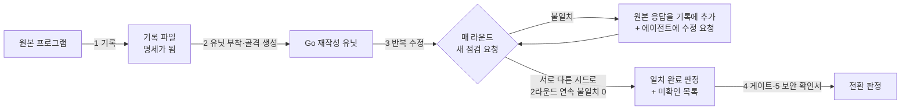

# 전체 워크플로우 (WORKFLOW)

**한 줄:** 원본 프로그램의 동작을 기록해 명세로 삼고, Go 재작성이 그 기록과 빈틈없이 같아질 때까지 자동 점검·수정을 반복한다.

## 1. 큰 그림

## 2. 단계별 설명

| 단계 | 명령 | 누가 | 하는 일 | 결과물 |
|---|---|---|---|---|
| 0 | - | 사용자 | 옮길 프로그램(원본)을 직접 띄운다. 프로그램이 보낼 시험 입력을 정한다 | - |
| 1 | `record` (명령행 프로그램) / `app record` (HTTP 서비스) | 도구 | 원본의 입출력을 그대로 적는다. HTTP는 케이스마다 2번 반복해 매번 달라지는 필드를 `unstable`로 표시한다 | `rec.json` / `app.json` |
| 2 | `wire gen <root> <unit> [prefix]` | 도구 (+에이전트) | 유닛 폴더와 기록 테스트를 만들고 `main.go`에 연결한다. `-agent`를 주면 기록만 보여주고 첫 재작성을 맡긴다 | `units/<unit>/` |
| 3 | `wire refine …` | 도구 + 에이전트 | 매 라운드 새 점검 요청을 양쪽에 보낸다. 다른 요청은 원본 응답과 함께 기록에 추가하고, 재작성 결함만 에이전트에게 수정 요청한다 | `.go-anything/checks/<unit>/` (라운드별 실행 기록 JSON + HTML) |
| 4 | `gate -root .` | 도구 | gofmt·vet·build·test, 미구성 코드, `unsafe` 사용 점검 | 종료 코드 |
| 5 | `secure -root .` | 도구 + 사람 | 보안기능 확인서 체크리스트 39항목을 코드로 대조한다. 사람이 확인할 항목은 사람이 한다 | `.go-anything/security/` |
| 6 | `rbac …` 또는 `wire refine -rbac-principals … -rbac-policy …` | 도구 | 모든 케이스를 여러 사용자 자격으로 보내 허용·거부를 선언된 정책·원본과 비교한다 | 결함 목록 |
| 7 | `lift` / `shadow` / `bench` / `fuzz` / `analyze` | 도구 | 재작성이 원본을 대체할 준비가 됐는지 판정한다 | 리포트 |
| 8 | - | - | 라운드별 실행 기록·리포트를 `WORK/Result/<작업-ID>/`에 모은다 | `WORK/Result/` |

## 3. 반복 수정의 판정 규칙 (가장 중요)

- **원본의 응답이 정답이다.** 재작성이 원본과 다르면 재작성이 틀린 것이다.
- **차이는 셋으로 나눈다.** 재작성 결함(수정 요청) / 원본 결함(결함 목록에만 기록, 재작성이 베끼지 않는다) / 서버 오류(높음 등급으로 기록).
- **일치 완료 = 서로 다른 시드로 2라운드 연속 불일치 0.** 1라운드는 증거가 아니다. 치명적 권한 결함이 있으면 완료가 아니다.
- **미확인 목록은 판정의 일부다.** 시험하지 못한 입력 종류를 그대로 적는다. 초록 판정을 과장하지 않는다.
- 원본이 죽거나 일관성이 없으면 재작성 결함과 분리해 결함 목록에 남긴다.

## 4. 저장소 안의 것들

| 위치 | 역할 |
|---|---|
| `cmd/go-anything/` | CLI 명령 연결과 명령 목록 |
| `internal/domain/` | 케이스·비교·리포트·체크리스트 모델 (순수 함수, 표준 라이브러리만) |
| `internal/usecase/` | 기록·검증·반복 수정 규칙·재작성 생성 |
| `internal/adapter/` | 앱 러너, `wire gen`, `analyze`, `secure`, MCP |
| `docs/` | `STATUS.md`(지금), `WORKFLOW.md`(이 문서), `TERMS.md`(용어), `HARDENING.md`, `RSI_PLAN.md`, `DECISIONS.md`, `reports/` |
| `WORK/` | 결과물. `Backup/`은 기존 데이터, `Result/`는 새 결과물 |

`internal/domain/compare.go`와 `answer.go`는 생성되는 유닛 테스트에 그대로 복사된다. 그래서 도구와 재작성의 `go test`가 같은 코드로 판정한다.

## 5. 한 세션의 진행 방법 (에이전트·사람 공통)

1. `docs/STATUS.md`의 "지금 하는 일"을 확인한다.
2. 작업 ID를 정하고 `docs/task-id/<작업-ID>/state.json`을 만든다. 결과물은 `WORK/Result/<작업-ID>/`에 둔다.
3. 변경 뒤에는 `gofmt -l .`, `go vet ./...`, `go test -race -count=1 ./...`를 돌리고 종료 코드를 적는다.
4. 작업이 끝나면 `docs/STATUS.md`의 "지금 하는 일·다음 할 일"을 고친다. 긴 로그는 STATUS에 쓰지 않고 `WORK/Result/`에 남긴다.
